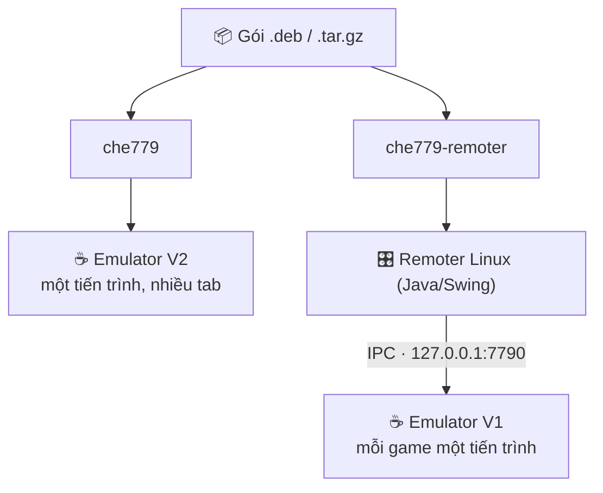

<div align="center">

# 🐧 Che779 Linux

**Giả lập game Java (J2ME) cho Linux — Emulator V2, Emulator V1 và Remoter Linux trong một gói cài.**

Cài một gói `.deb` (hoặc giải nén `.tar.gz`), gõ `che779` là chơi.
Dựa trên MicroEmulator 3.0.0, thêm lớp Che779: tab, lưới, proxy theo tab, đồng bộ thao tác và dọn RAM.

> **Nền tảng: Linux.** Quy ước 4 repo: **P1 và P2 = Windows · P3 = Linux (kèm Termux) · P4 = Android**. Termux (Android) nằm ngay trong repo này, thư mục `apps/termux/`.

[](../../releases/latest)
[](../../releases)
[](../../actions)
[](#-tải-về)
[](#-yêu-cầu-hệ-thống)
[](LICENSE)

[Tải về](#-tải-về) · [Tính năng](#-tính-năng) · [Bắt đầu nhanh](#-bắt-đầu-nhanh) · [Hướng dẫn](#-hướng-dẫn-sử-dụng) · [Hỏi đáp](#-hỏi-đáp-và-xử-lý-lỗi) · [Build](#-build-từ-mã-nguồn) · [Tài liệu](#-tài-liệu) · [Ghi công](#-ghi-công-và-giấy-phép)

</div>

---

## 📥 Tải về

Vào mục **[Releases](../../releases/latest)** và chọn một trong ba cách:

| File | Dùng khi | Ghi chú |
|---|---|---|
| `che779_<phiên bản>_all.deb` | Ubuntu, Linux Mint, Debian và bản phái sinh | **Khuyên dùng.** `apt` tự cài Java chính thức nếu thiếu; có V2 + V1 + Remoter |
| `che779-<phiên bản>-linux.tar.gz` | Mọi distro | Giải nén là chạy; cần tự có Java |
| `che779-linux.sh` | Mọi distro, chỉ cần V2 | Một file có sẵn V2 bên trong; giữ tạm |

**Termux (Android)** có bản riêng, thẻ riêng `termux-v*`: file `che779-termux.sh` (xem `apps/termux/README.md`). Hai bản tách hẳn: `che779-linux.sh` cho máy tính, `che779-termux.sh` cho điện thoại.

Mỗi bản phát hành có kèm `SHA256SUMS.txt` để kiểm tra file tải về có nguyên vẹn không:

```bash
sha256sum -c SHA256SUMS.txt
```

Mã SHA-256 được tính **sau cùng** trên đúng các file đăng ở Releases. Riêng `che779-linux.sh` còn tự kiểm tra jar nhúng bên trong và từ chối chạy nếu sai.

> Chưa thấy file nào ở Releases? Bản phát hành được tạo tự động khi chủ dự án gắn thẻ phiên bản. Trong lúc đó bạn có thể [tự build](#-build-từ-mã-nguồn).

---

## 🌐 Hệ sinh thái Che779

Che779 gồm 4 dự án, mỗi dự án một repo. Bạn đang xem **Project 3**.

| # | Dự án | Chạy trên | Dùng khi nào |
|:-:|---|---|---|
| 1 | [**Che779-Emulator**](https://github.com/Kidtomboy/Che779-Emulator) | Windows | Mỗi tab một cửa sổ, điều khiển bằng Remoter |
| 2 | [**Che779-EmulatorV2**](https://github.com/Kidtomboy/Che779-EmulatorV2) | Windows | Nhiều tab trong một cửa sổ, một tiến trình |
| 3 | **Che779-Linux** ← *bạn đang ở đây* | Linux + Termux | Gói `.deb` / `.tar.gz`: V2 + V1 + Remoter Linux; script Termux (Android) |
| 4 | [**Che779-Android**](https://github.com/Kidtomboy/Che779-Android) | Android | APK chạy trực tiếp trên điện thoại |

**V1 hay V2?** V1 (lệnh `che779-remoter`) cho mỗi game một tiến trình riêng nên cách ly tốt nhưng tốn RAM. V2 (lệnh `che779`) gom các tab vào một tiến trình nên nhẹ hơn và mở là dùng; đổi lại một lỗi nặng ở tầng Java có thể ảnh hưởng cả cửa sổ.

---

## ✨ Tính năng

### Emulator V2 — lệnh `che779`

| | Tính năng | Mô tả |
|:-:|---|---|
| 🗂️ | **Nhiều tab, một cửa sổ** | Mỗi tab có thiết bị, RMS (dữ liệu lưu game), class loader và proxy riêng |
| 🔲 | **Chế độ Tab / Lưới** | Xem từng tab hoặc tất cả cùng lúc; game tự thu phóng vừa ô |
| 🛡️ | **Tab lỗi không kéo sập tab khác** | Có nút *Khởi động lại game* và *Xem log* |
| 🔁 | **Đồng bộ phím và chuột** | Thao tác ở một tab được nhân ra các tab đã chọn |
| 🌐 | **Proxy theo tab** | HTTP và SOCKS5; mỗi tab một proxy hoặc chia vòng từ kho proxy |
| 🔀 | **Thay IP máy chủ** | Ưu tiên `server.txt` trong jar game, rồi `servers.txt`, rồi tự nhập |
| 🧹 | **Dọn RAM** | Dọn ngay hoặc tự dọn theo ngưỡng HEAP |

### Emulator V1 + Remoter Linux — lệnh `che779-remoter`

| | Tính năng | Mô tả |
|:-:|---|---|
| 🪟 | **Mỗi game một cửa sổ** | Một tiến trình riêng cho từng game, cách ly tốt |
| 🎛️ | **Remoter Linux (Java/Swing)** | Giao diện tối, 6 khu vực bám Remoter Windows: đường dẫn, cấu hình tab/lưới, hành động, danh sách tab (CPU/RAM/PID), đồng bộ và bàn phím, tiện ích |
| 📐 | **Sắp xếp cửa sổ** | Bằng `xdotool` (X11) |
| 🔌 | **IPC** | Remoter điều khiển emulator qua TCP `127.0.0.1:7790`, JSON từng dòng |

Bảng đối chiếu Windows ↔ Linux và chức năng chưa làm (Xem lưới, Macro): [`apps/linux/remoter-linux/README.md`](apps/linux/remoter-linux/README.md).

---

## 🖥️ Yêu cầu hệ thống

| | Yêu cầu |
|---|---|
| Hệ điều hành | Linux (đã thử Ubuntu 24.04) |
| Java | **Java 8 trở lên** (gói `.deb` tự yêu cầu Java chính thức) |
| Màn hình | Đồ họa X11 hoặc Wayland. Không có màn hình (SSH/máy chủ): cài `xvfb`, lệnh tự dùng màn hình ảo (không thấy cửa sổ) |
| Tùy chọn | `xdotool` để Remoter sắp xếp cửa sổ (X11); gói `.deb` chỉ *đề xuất* |
| RAM | Tùy số tab và game; V2 nhẹ hơn V1 |

Cài Java bằng gói chính thức của distro: `sudo apt install default-jre`.

---

## 🚀 Bắt đầu nhanh

**Gói `.deb`** (Ubuntu / Mint / Debian):

```bash
sudo apt install ./che779_1.3.1_all.deb
che779                 # Emulator V2
che779-remoter         # Emulator V1 + Remoter
```

**Gói `.tar.gz`** (mọi distro):

```bash
tar xzf che779-1.3.1-linux.tar.gz && cd che779-1.3.1-linux
./che779               # hoặc ./che779-remoter
```

**Một file `che779-linux.sh`:** `bash che779-linux.sh` (chạy V2; nếu thiếu Java, script cài bằng gói chính thức của distro, cần `sudo`).

Chọn RAM: `che779 -r 2048` (MB). Mở sẵn game: `che779 /đường/dẫn/game.jar`. Không truyền game thì V2 mở lại các tab của lần trước.

---

## 📱 Termux (Android)

Dành cho ai muốn chạy **Emulator V2** trên điện thoại qua Termux. Chỉ V2 được hỗ trợ; Termux khó thao tác hơn APK, nên người dùng Android thông thường nên dùng [Che779-Android](https://github.com/Kidtomboy/Che779-Android).

**Phải cài tay trước (script không tự cài được):**
1. **Termux** (từ F-Droid hoặc GitHub của Termux, *không* dùng bản Google Play đã cũ).
2. **Termux:X11** (ứng dụng Android, tải APK ở GitHub của Termux:X11). Script chỉ cài phần `termux-x11-nightly` bên trong Termux, còn ứng dụng hiển thị thì bạn tự cài.
3. Cấp quyền bộ nhớ cho Termux: chạy `termux-setup-storage` rồi bấm Cho phép.

**Chạy:** tải `che779-termux.sh` ở Releases (thẻ `termux-v*`), rồi trong Termux: `bash che779-termux.sh`. Lần đầu script tự cài `x11-repo`, `termux-x11-nightly`, `proot-distro`, Ubuntu (proot), Java 17/21, Openbox và vài thư viện X; **tải vài trăm MB đến hơn 1 GB và mất nhiều phút**, cần mạng ổn định và còn dung lượng. Mở ứng dụng Termux:X11 để thấy cửa sổ.

**Chỗ khó thao tác:** cài hai ứng dụng tay; cấp quyền bộ nhớ; lần cài đầu lâu; thao tác chuột/bàn phím trong X11 trên màn hình cảm ứng khó hơn APK; máy ít RAM dễ bị hệ thống tắt Termux. Chi tiết, tùy chọn (`-r`, `-g`, `--doctor`, `--reset`…) và cách build: `apps/termux/README.md`. Game: `Download/Che779Games`; dữ liệu: `Download/Che779Data`.

---

## 📖 Hướng dẫn sử dụng

- **Thêm game:** dùng **Thêm Game** hoặc mở game vào tab trống để chọn file `.jar`; hoặc truyền đường dẫn game ở dòng lệnh.
- **Ô tab (V2):** mỗi ô có `Tab N: [tên game]`, ô **Sync** (tham gia đồng bộ), nút **P** (proxy riêng) và nút **×** đóng game.
- **Đồng bộ:** menu Đồng bộ cho bật/tắt, chọn tab tham gia. Các tab nên cùng kích thước để tọa độ chuột trùng nhau.
- **Proxy:** **Che779 → Quản lý Proxy** để thêm, nhập, kiểm tra proxy; gán cho từng tab hoặc chia vòng.
- **Bộ nhớ:** thanh dưới hiện CPU/HEAP; dọn RAM ngay hoặc đặt ngưỡng tự dọn.
- **Remoter:** chọn thư mục game và số tab, mở, rồi dùng khu vực hành động/đồng bộ để điều khiển tất cả cửa sổ; **Sắp xếp** cần `xdotool`.
- **Khi game lỗi:** tab hiện "Game đã thoát" hoặc "Tab gặp sự cố" kèm **Xem log** và **Khởi động lại game**.

---

## ⚙️ Cấu hình và nơi lưu dữ liệu

| Chương trình | Dữ liệu | Game |
|---|---|---|
| V2 (`che779`) | `~/.che779` | `~/Che779Games` |
| Remoter (`che779-remoter`) | `~/.che779/Che779-Remoter` (cấu hình), `~/.che779/Che779-Emulator` (Emulator V1) | chọn trong Remoter |

Dữ liệu **không** ghi vào thư mục cài hay thư mục giải nén, nên cập nhật bản mới không mất dữ liệu. Khi báo lỗi, gửi file log trong thư mục dữ liệu.

---

## 🧩 Cách hoạt động



Mã Emulator **không chép** vào repo này: Actions lấy Che779-Emulator và Che779-EmulatorV2 đúng commit ghim ở `apps/linux/EMULATOR_V1_REF` và `EMULATOR_V2_REF`, build jar rồi đóng gói. Chi tiết: [`docs/ARCHITECTURE.md`](docs/ARCHITECTURE.md). Giao thức IPC: xem repo Che779-Emulator.

---

## 🔧 Build từ mã nguồn

Cần `git`, JDK 8+ (và `dpkg-deb` để làm `.deb`):

```bash
bash scripts/fetch-sources.sh      # lấy mã V1, V2 đúng commit đã ghim
bash scripts/build-jars.sh         # build 3 jar vào build/jars
bash scripts/package-tar.sh        # dist/che779-<ver>-linux.tar.gz
bash scripts/package-deb.sh        # dist/che779_<ver>_all.deb
bash scripts/build-release.sh build/jars/Che779_EmulatorV2.jar   # dist/che779-linux.sh
```

Kiểm thử: `bash tests/test-script.sh` và `bash tests/test-packages.sh`.

Chủ dự án phát hành bằng cách gắn thẻ `vX.Y.Z`: workflow **Phát hành** build, đóng gói và tạo `SHA256SUMS.txt` (sau cùng). Chi tiết: [`docs/BUILD_AND_RUN.md`](docs/BUILD_AND_RUN.md).

---

## ❓ Hỏi đáp và xử lý lỗi

| Bạn gặp | Làm gì |
|---|---|
| `che779: không có màn hình` | Chạy trong desktop, hoặc `sudo apt install xvfb` |
| Thiếu Java | `sudo apt install default-jre` (gói `.deb` tự cài) |
| Remoter không sắp xếp được cửa sổ | `sudo apt install xdotool`; Wayland thuần chưa hỗ trợ |
| Game không vào được mạng | Đổi máy chủ ("Thay IP") hoặc đặt proxy cho tab. Lỗi còn có thể do chính máy chủ game |
| Đồng bộ chuột không trúng vị trí | Đặt các tab cùng một kích thước màn hình |
| Muốn báo lỗi | Mở [Issue](../../issues/new/choose), ghi `che779 --version`, distro và Java; chạy `bash che779-linux.sh --doctor` nếu dùng file `.sh`. Xóa mật khẩu proxy khỏi log |

---

## ⚠️ Giới hạn và vấn đề đã biết

- **Đã thử** (Claude, Ubuntu 24.04, JDK 21, màn hình ảo Xvfb): build 3 jar; tạo `.deb` + `.tar.gz`; cài `.deb`; `che779` chạy V2 với game thật; ghép và kiểm thử `che779-linux.sh`; Remoter Linux mở 3 tab với V1.
- **Chưa thử:** máy có màn hình thật và trình quản lý cửa sổ; Wayland; `.deb` trên Debian/Mint thật; Fedora/Arch/Alpine/openSUSE (`che779-linux.sh` tự cài Java); sắp xếp tab bằng `xdotool`.
- Remoter Linux chưa có **Xem lưới** và **Macro**.
- Tất cả tab V2 dùng chung một JVM: lỗi nặng ở tầng Java có thể ảnh hưởng cả cửa sổ.
- **IPC chưa có xác thực:** tiến trình khác trên cùng máy biết cổng thì gửi được lệnh. Không mở cổng này ra mạng. Xem [`SECURITY.md`](SECURITY.md).
- Mật khẩu proxy được lưu dạng chữ thường.

Phần nào đã kiểm chứng, phần nào chưa: [`docs/TESTING.md`](docs/TESTING.md). Danh sách lỗi đầy đủ: [`docs/DEBUG_LOG.md`](docs/DEBUG_LOG.md).

---

## 🗂️ Cấu trúc repo

```
Che779-Linux/
├─ README.md  CONTRIBUTING.md  SECURITY.md  LICENSE  CHANGELOG.md  VERSION
├─ THIRD_PARTY_NOTICES.md
├─ apps/
│  ├─ termux/             Script Termux (che779-termux.sh), build-termux.sh, fetch-jar.sh, EMULATOR_V2_REF, VERSION riêng
│  └─ linux/
│     ├─ che779-linux.sh          Nguồn script một file
│     ├─ packaging/         Lệnh che779, che779-remoter, .desktop
│     ├─ remoter-linux/     Mã Remoter Linux (Java/Swing)
│     └─ EMULATOR_V1_REF  EMULATOR_V2_REF   Commit ghim của P1, P2
├─ scripts/               fetch-sources, build-jars, package-tar, package-deb, build-release
├─ docs/                  Tài liệu kỹ thuật (có mục lục)
├─ tests/                 test-script.sh, test-packages.sh, RemoterCoreTest.java
└─ .github/               Workflow CI + Phát hành, mẫu Issue và Pull Request
```

---

## 📚 Tài liệu

[Mục lục](docs/README.md) · [Trạng thái](docs/PROJECT_STATE.md) · [Kiến trúc](docs/ARCHITECTURE.md) · [Build và chạy](docs/BUILD_AND_RUN.md) · [Kiểm thử](docs/TESTING.md) · [Lỗi đã biết](docs/DEBUG_LOG.md) · [Quyết định](docs/DECISIONS.md) · [Lộ trình](docs/ROADMAP.md) · [Fork và bản tự build](docs/VARIANTS_AND_CLONES.md) · [Nguồn gốc mã](docs/SOURCE_INVENTORY.md) · [Bàn giao](docs/AI_HANDOFF.md)

---

## 🤝 Đóng góp và bảo mật

Muốn góp sức? Đọc [`CONTRIBUTING.md`](CONTRIBUTING.md). Tìm thấy lỗ hổng bảo mật? Xem [`SECURITY.md`](SECURITY.md) và báo riêng, đừng đăng công khai.

---

## 🙏 Ghi công và giấy phép

Dựa trên **[MicroEmulator](https://github.com/barteo/microemu)** 3.0.0 (Apache License 2.0). Mã Che779 được viết lại. Giữ nguyên thông báo bản quyền khi phân phối lại; xem [`LICENSE`](LICENSE) và [`THIRD_PARTY_NOTICES.md`](THIRD_PARTY_NOTICES.md).

<div align="center">

Làm bởi **Cherry** · [Báo lỗi](../../issues/new/choose) · [Đóng góp](CONTRIBUTING.md) · [Bảo mật](SECURITY.md)

</div>
